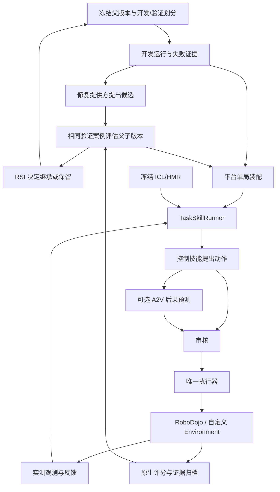

# ThinkerWAM-RSI 代码架构

更新：2026-11-05。当前内置平台是 RoboDojo；通用接口保留新平台扩展能力。
运行方法见 [使用说明](RSI_USAGE.md)，经验方法见 [HMR / ICL](EXPERIENCE_GUIDE.md)。

逐目录、逐模块说明见 [目录内容指南](DIRECTORY_GUIDE.md)。根目录不再有 runtime；平台与模型目录中的 runtime 是正式运行实现，compat/legacy/runtime 才是历史入口。

## 1. RSI 与一次任务运行

单局中“观测→决策→执行→反馈”是闭环控制。RSI 外层在多个版本之间执行
“开发失败→提出程序/提示词/经验修改→配对验证→继承或保留→下一轮”。
仅加载冻结 HMR、运行 A2V 审核或调用 Agent，并不等于启动自我改进。

两种公开入口：

- `python -m rsi episode`：固定版本单局运行，调用通用 `execution.episode.run_episode`。
- `python -m rsi campaign`：真实 RSI 外层，调用 `scripts/run_framework_campaign.py`。

已有 RoboDojo 模型实验继续使用 Python 函数 `environments.robodojo.framework.run_framework_episode`。
旧导入需要显式启用 compat。通用 CLI 不会自动替用户装配 WAM、PI0.5 或 EEF 策略。

## 2. 目录职责

```text
rsi/                         仅外层 RSI 核心
  framework_campaign.py      开发运行、父子配对验证与继承
  core_adapter.py            对接 RSI 核心与评估生命周期
  proposal_adapter.py        开发证据、候选修改与物化
  version_manifest.py        候选闭包、版本身份与内容哈希
  selection_policy.py        可继承的技能/工具选择策略
  __init__.py                轻量包入口，不加载兼容层
  __main__.py                保留 python -m rsi 命令入口
execution/
  episode.py                 跨平台单局装配与快照
  runner.py                  任务循环、技能调用与唯一执行器
  review.py                  审核决策、前缀与动作约束检查
  feedback.py                实测操作反馈
  trajectory.py              轨迹日志、数据角色与动作哈希
agents/                      模型客户端、上下文、DeepSeek 与调用预算
skills/
  contracts.py               控制技能、模型技能、提案与反馈协议
  chunk_backend.py           通用显式 commit/discard 生命周期
  direct/                    Direct 控制技能
  wam/                       WAM 后端与 RSI 技能适配
  pi05/                      PI0.5 HTTP/NPZ 后端
tools/
  contracts.py               工具接口、预算与动作绑定收据
  prediction/a2v.py          固定审核链路与独立调用共用的预测实现
  perception/                感知、几何、目标测量与 camera.py 相机适配
  measurement.py             测量工具装配
experience/
  packages.py                HMR/ICL 封装、catalog 与冻结工作区
  README.md                  经验包格式与接入说明
  templates/                 HMR/ICL Markdown 模板
  examples/                  教学正文、封存包和可加载 catalog
data/                        恢复轨迹、训练清单与离线数据适配
environments/
  contracts.py               通用环境接口与动作契约
  registry.py                平台注册与创建
  robodojo/                  RoboDojo 实现，文件如下
    framework.py               Direct / WAM / PI0.5 完整装配
    environment.py             通用 Environment 的 RoboDojo 绑定
    training.py                平台数据与部署契约
    review_context.py          平台审核上下文
    action_revision.py         候选动作编辑与重采样
    metric_depth.py            平台深度处理
    pi05_diversity.py           PI0.5 候选多样性处理
    experiments/               冻结实验协议与复现入口
    runtime/                   平台观测、规划、审核协议与文件桥
third_party/
  Thinker-WM/                世界模型训练、推理和依赖的实际源码
  RoboProbe/                 现用 Joint/EEF 策略、类型和任务说明
compat/                      可选，正常框架不依赖
  legacy/                    原 runtime、adapters 包入口
  module_aliases.json        旧模块名映射
  tests/                     历史导入专属测试
thinker_wm.py                唯一模型加载入口，定位 Thinker-WM 实际源码
framework_cli.py             episode / campaign / platforms 命令实现
examples/modular/            可运行 CPU 示例
scripts/                     当前服务启动、数据和验证工具
```

`rsi/` 共 5 个业务核心模块，加上 2 个包/命令入口。新代码直接使用正式模块路径。
旧导入仅在显式启用 `compat` 后映射到同一实现；正常启动不安装兼容钩子。
根目录不再包含 `runtime/` 或 `adapters.py`。详见 [兼容说明](../compat/README.md)。

根目录不保留模型软链接；模型模块通过 `thinker_wm.py` 定位到唯一源码目录。
`third_party/Thinker-WM/UPSTREAM.json` 记录来源与文件哈希；权重和数据集不在其中。
PhysicalRSI_core、XPolicyLab、原生仿真器及其场景资产仍需单独提供。
RoboTwin 在线策略、观测适配、分块传输、客户端及服务配置已移除。
训练数据读取器和历史训练配置保留，用于世界模型训练与来源追溯，不提供在线平台注册。

### 不包含 compat 的发行方式

可以从源码副本中排除 `compat/`，其余正式代码使用正常入口运行。轨迹日志位于
`execution/trajectory.py`，相机适配位于 `tools/perception/camera.py`，RoboProbe 位于
`third_party/RoboProbe/`；WAM 运行实现通过 `thinker_wm.runtime.*` 导入。
模型侧执行循环与框架 `execution/episode.py` 仍各自负责原有职责。

使用 `scripts/test_without_compat.py` 在物理上不含兼容层的副本中验证，且禁止旧模块导入。
所需的模型、仿真器和外部核心依赖仍需准备；“不依赖 compat”不表示无需其他运行依赖。

### 新功能应该放在哪里

- 新仿真平台：`environments/<平台名>/`，实现公共环境契约并注册。
- 新控制技能：`skills/`，实现提案/反馈协议，通过工厂接入执行器。
- 新辅助工具：`tools/`；平台专用工具实现放在对应环境目录。
- 新 HMR/ICL 内容：从 `experience/templates/` 开始，封存为新经验包；真实内容放独立经验库。
- 新外层改进策略：`rsi/`；通用单局执行逻辑放 `execution/`。

## 3. 执行与改进的数据流



技能和审核回调不直接执行环境动作。预测不写入实测历史。评分单独进入评估通道，
不伪装成 Agent 的视觉/状态输入。发生不确定执行异常时，不自动重放动作。

## 4. 两个装配入口的边界

### RoboDojo 现有入口

`run_framework_episode(native_env, ...)` 使用原生观测字典、ARX-X5 joint14、25Hz。
它负责装配 `direct_policy`、WAM `client`、`pi05_client`、审核者、主管/selector 和经验。
扩展工厂签名是 `factory(load_observation)`，审核由 `skill_reviewers` 注册。
`action_spec` 是原生部署模块生成的约束对象，不是新的 ActionContract。

### 通用环境入口

`run_episode(environment, ...)` 接受 Environment 和显式 ActionContract，使用同一个 TaskSkillRunner。
工厂签名是 `factory(load_snapshot, model_budget)`；通过 `agent_factory` 提供选择和审核逻辑。
没有内置的 `client/pi05_client/reviewer/skill_reviewers` 参数。模型接入必须在工厂中完成。
`action_spec` 若提供，必须与 `environment.contract` 相等。

两者不能只改函数名就互换参数。新平台优先实现通用协议，已有 RoboDojo 模型实验优先沿用完整装配。

## 5. Skill、Tool、Experience 与 Backend

- `direct_control`：Agent/策略提出 EEF 计划或其他直接动作方案。
- `wam_control`：世界模型产生动作候选，可附带未来观测预测。
- `vla_control`：目前为 PI0.5 动作提案。
- 自定义技能：注册新的名字，实现相同提案/反馈协议。
- ICL：供决策参考的示范、任务说明或示范片段。
- HMR：供决策参考的历史尝试、失败、反馈及经验记录。
- A2V：对给定动作预测视觉后果，供审核者比较候选。

对外按“控制技能 + 辅助工具”组织：读取/检索 HMR、读取 ICL 示范、感知测量和 A2V
属于工具能力；HMR/ICL 内容本身是数据。A2V 同时支持既有固定审核链路和
独立 TaskTool 调用。外层 RSI 可修改冻结选择策略，内层 Agent 在宿主约束内调用。
详见 [选择策略与工具](SELECTION_TOOLS.md)。

因此通常调用 `CallSkill("wam_control", ...)`，而不是 `CallSkill("hmr", ...)`。
“仅 HMR”表示只开启 HMR 经验输入，仍然需要 Direct/WAM/VLA 中的一种控制来源。
AR 实测历史和 KV/prefix cache 属于模型运行状态，不是 HMR 经验包。

## 6. Agent 角色与通信

主管决定选哪个技能；控制 Agent 提出控制指令；审核 Agent 选择候选/执行前缀。
这些是角色，不表示每局必须创建三个大模型会话。固定链路可以没有主管。
代码 selector 也不是额外的大模型。文件桥与 HTTP 客户端只是通信机制。

RoboDojo 函数不传 `supervisor_client` 时不会创建大模型主管；多个技能未配置 selector 时
按 WAM→VLA→Direct 的默认优先级选择。现有 `run_codex_eef_live.py` 的 framework
启动路径有自己的主管配置，不能把函数默认值当成所有启动脚本的默认值。

## 7. 外层改进与身份

FrameworkSuite 的 `episode_runner` 由可信 host driver 注入并进入实现身份；默认仍是 RoboDojo 入口。
候选的 `configure(root, case)` 只能返回允许的策略/经验/工具选项，不能覆盖固定资源、预算或执行器。
开发、验证、测试分离；每轮评测冻结候选；仅在轮次之间决定继承。

Harness-RSI 改程序/提示词/经验。Data-RSI 通过数据角色、训练清单与独立训练阶段更新模型。
本版保留 Data-RSI 接口，不提供“运行 episode 就自动训练”的隐式行为。

## 8. 当前验证范围

已验证 CPU 协议、RoboDojo 格式替身、冻结经验、预算、旧装配回归，以及真实 RSI
核心在替身环境中的继承/保留。新通用入口的真实仿真完整任务、GPU 数值一致性和真实改进收益
须单独评测。验证方法见 [使用说明](RSI_USAGE.md) 和 [通用核心](HARNESS_CORE.md)。


## 环境目录与经验材料整理

平台接口和实现统一在 `environments/`：`contracts.py` 定义接口，`registry.py` 注册平台，
`robodojo/` 实现 RoboDojo。新增平台放到 `environments/<平台名>/`。
原 adapters 与 runtime 旧入口已收进可选 compat，正式代码直接导入新目录。
新代码使用 `rsi.core_adapter`；旧核心适配导入保留兼容。

经验材料见 [experience/README](../experience/README.md)：模板、教学正文、封存包和可加载 catalog。
真实实验产生的经验存放在独立输出目录，评测使用冻结版本。


候选路径校验、通用 backend_version、旧 WAM 兼容和核心安装边界见 [通用核心](HARNESS_CORE.md)。
